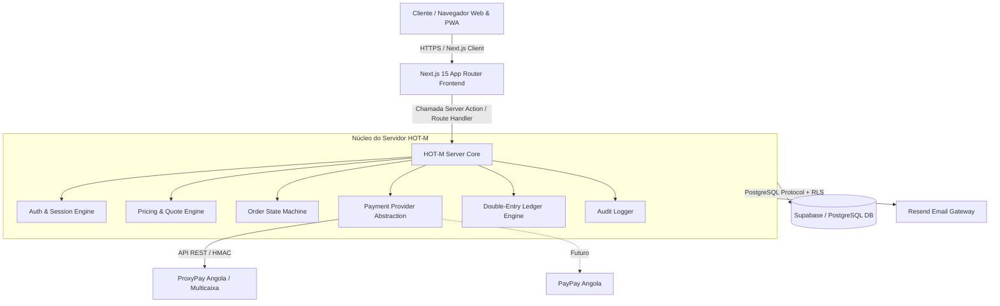

# ARQUITETURA CANÓNICA DO SISTEMA — HOT-M

## 1. Visão Geral
O HOT-M é uma plataforma transacional de comércio digital e creator economy inspirada funcionalmente em ecossistemas globais de infoprodutos, operando com integridade financeira estrita, contabilidade por partidas dobradas (double-entry ledger) e segurança zero trust.

## 2. Princípios Arquiteturais Centrais
1. **Fonte Única de Verdade:** Supabase (PostgreSQL 15+) gerencia toda a persistência, integridade referencial e auditoria.
2. **Princípio do Privilégio Mínimo (Least Privilege):** RLS ativado em todas as tabelas, funções sensíveis executadas estritamente no servidor via Server Functions / API Routes. O navegador nunca possui credenciais elevadas (`service_role`).
3. **Imutabilidade Financeira:** Toda transação financeira é registrada em livro-razão (ledger) de dupla entrada com débitos estritamente iguais a créditos. Nenhuma linha do ledger pode ser deletada ou editada.
4. **Isolamento de Domínio e Invariantes Absolutos:**
   - O navegador nunca define nem confirma preços (INV-001, INV-003).
   - Ordens precedem tentativas de pagamento (INV-002).
   - Webhooks são idempotentes; repetições são idempotentemente dedublicadas (INV-004).
   - Saques e reembolsos exigem transações atômicas com verificação de saldo e KYC prévio (INV-009, INV-011).

## 3. Diagrama de Fluxo e Topologia

## 4. Camadas da Aplicação
- `src/app`: Camada de apresentação e rotas da aplicação (Next.js App Router).
- `src/core/config`: Validação tipada de variáveis de ambiente com bloqueio de vazamentos.
- `src/core/fintech`: Motor financeiro de alta precisão (Money integer minor units, Ledger de dupla entrada, State Machines).
- `src/core/security`: RBAC, matriz de autorização e trilha de auditoria.
- `src/modules`: Domínios funcionais isolados (auth, products, orders, payments, entitlements, withdrawals, etc.).
