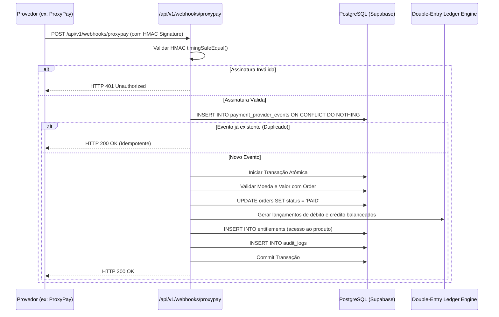

# MOTOR DE PROCESSAMENTO DE WEBHOOKS — HOT-M

## 1. Princípios de Segurança e Resiliência
- **Idempotência Estrita (INV-004):** Cada evento de gateway possui um identificador unívoco gravado em `payment_provider_events`. Requisições duplicadas (retries da rede ou do gateway) são registradas como `DUPLICATE` e retornam `HTTP 200` imediatamente sem reexecutar efeitos colaterais.
- **Validação Criptográfica:** Payloads não autenticados via HMAC SHA256 são rejeitados com `HTTP 401 Unauthorized`.
- **Processamento Assíncrono / Transacional:** A transição do pedido para `PAID`, a emissão das entradas do ledger e a criação dos direitos de acesso (`entitlements`) ocorrem em uma única transação atômica de banco de dados.

## 2. Diagrama de Fluxo de Ingestão

